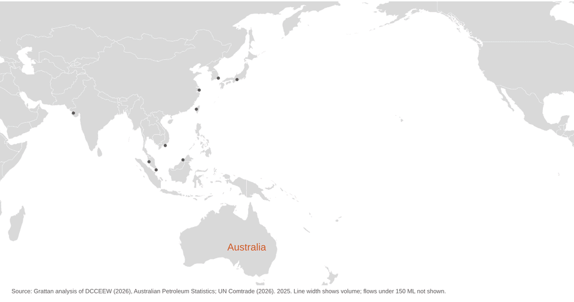

# Australia's fuel imports and the crude oil behind them



This code makes the map of Australia's 2025 imports of petrol, jet fuel and diesel, and where the crude oil behind them was produced. The map appears in *Fuelling the future: The Grattan Fuel Plan for Australia*. The code also makes the animated version above.

The map is drawn in R with ggplot2. The animation is drawn frame by frame in Python with matplotlib, and ffmpeg joins the frames into a GIF.

## What you need

- R 4.3 or later, with these packages. The map needs ggplot2 4.0 or later, which comes with a current tidyverse.

  ```r
  install.packages(c("tidyverse", "readxl", "jsonlite", "maps"))
  ```

- Python 3 with `matplotlib`, `pandas` and `numpy`.
- [ffmpeg](https://ffmpeg.org/), a free command-line program that joins images into video.

## How to run it

Run each command from this folder.

```sh
Rscript R/download_comtrade.R         # 1. download the UN Comtrade crude import files (about 30 seconds)
Rscript R/octopus-map.R               # 2. draw the map: atlas/octopus-map.pdf
Rscript R/export_flows.R              # 3. write the flows and curves to export/*.csv
python3 animation/run_parallel.py     # 4. draw the 388 frames: animation/frames/
```

Then join the frames into a GIF:

```sh
ffmpeg -framerate 20 -i animation/frames/f%04d.png \
  -vf "scale=960:-1:flags=lanczos,split[a][b];[a]palettegen=max_colors=128:stats_mode=diff[p];[b][p]paletteuse=dither=sierra2_4a:diff_mode=rectangle" \
  -loop 0 animation/octopus-map-animated.gif
```

Or into an MP4:

```sh
ffmpeg -framerate 20 -i animation/frames/f%04d.png -c:v libx264 -crf 20 -pix_fmt yuv420p animation/octopus-map-animated.mp4
```

The `export/` folder already holds the output of step 3. To make only the animation, skip to step 4.

The UN Comtrade public API limits how often it can be called. If step 1 stops with an error, wait a minute and run it again.

## What the scripts do

| Script | What it does |
|---|---|
| `R/download_comtrade.R` | Downloads crude oil imports by partner country for the eight main suppliers of refined fuel to Australia. |
| `R/octopus-map.R` | Reads the raw files, calculates every figure, builds the curves and draws the map. |
| `R/export_flows.R` | Runs the map script up to the plot and writes the flows, curves, labels and colours to `export/`. |
| `animation/octopus_animate.py` | Reads `export/` and draws one frame for each twentieth of a second. |
| `animation/run_parallel.py` | Runs the frame drawing on every processor core. |

The animation has four steps:

1. Refined fuel lines grow from the eight Asian suppliers to Australia, and each supplier's share appears.
2. Crude lines grow into those suppliers, one source at a time: the Persian Gulf, then the United States, Russia and all other countries. Each source's share counts up as its lines grow.
3. Small oil barrels travel along every route. All barrels move at the same speed and are spaced in proportion to volume, so busier routes carry more barrels.
4. Crude from sources other than the Gulf fades back, and the Gulf's 55 per cent stands out. The map then fades out and the loop restarts.

## How to change the animation

The timing is set by the constants near the top of `animation/octopus_animate.py`: `T_REFINED`, `T_CRUDE`, `T_FLOW`, `T_GULF`, `T_FADE`, `T_END` and `GROW`, all in seconds.

To preview single moments without drawing every frame, give the script the seconds you want:

```sh
python3 animation/octopus_animate.py 3 12 16
```

This writes `animation/preview_03.00.png`, `preview_12.00.png` and `preview_16.00.png`.

## How to use it for your own flows

The animation reads only the files in `export/`. Replace them with your own data in the same layout and the animation script will draw it.

| File | Columns | Contents |
|---|---|---|
| `refined_paths.csv` | `supplier, ML, x, y` | One curve for each supplier, as a series of points, with its volume. |
| `crude_paths.csv` | `group, source, supplier, ML, x, y` | One curve for each source and supplier pair. |
| `suppliers.csv` | `supplier, lon, lat, lx, ly, hj, share, refined_imports_ML` | Supplier locations, label positions and shares. |
| `sources.csv` | `source, src_lon, src_lat` | Crude source locations. |
| `source_shares.csv` | `source, ML, share_pct` | Each source's share of the total. |
| `locations.csv` | `supplier, lon, lat, lx, ly, hj` | The dots drawn on the map. |
| `world.csv` | `long, lat, group, order, region, subregion` | Country outlines from the R `maps` package. |
| `colours.csv` | `name, value` | The colours used. |

Source names, label positions and the map's extent are set in `animation/octopus_animate.py`.

## Headline figures

| Crude source | Share of the crude behind Australia's fuel imports, 2025 |
|---|---|
| Persian Gulf | 54.6% |
| All other countries | 29.4% |
| United States | 12.1% |
| Russia | 4.0% |

## Data

- **Australian Petroleum Statistics**, Department of Climate Change, Energy, the Environment and Water, data extract dated August 2026. Licensed under Creative Commons Attribution 4.0 International. The file is in `data/raw/aps/`.
- **UN Comtrade**, United Nations Statistics Division. Imports of crude oil (HS 2709) by partner country, 2025 (2024 for Taiwan). These files are downloaded by `R/download_comtrade.R` and are not stored here. UN Comtrade revises its data, so a later download can give slightly different figures.

`data/raw/SOURCE.md` has the full details of both sources.
